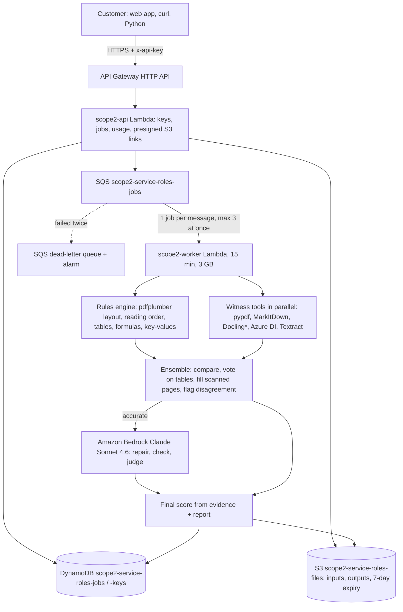

# Scope 2 design note (v4: serverless + ensemble of extraction tools)

## Goal
A stranger uploads a PDF or gives a URL and gets back Markdown + JSON in which **every element carries a score that
can be explained**, built from several independent tools instead of one. Reliability and accuracy come first;
processing time and cost are reported, not optimised.

## Architecture

*Docling runs in the optional container worker (`WITH_DOCLING=1`) and in local runs (`scripts/compare_tools.py`).

All AWS resources follow the trainer's role: both Lambdas use the single existing role
`scope2-service-lambda-exec`; tables, bucket and queues are named `scope2-service-roles-…`; functions `scope2-…`.
**The stack creates no IAM resources.** Encryption at rest uses AWS-managed keys (S3 SSE, DynamoDB SSE, SQS SSE),
so no customer KMS key is needed. The Azure key is a CloudFormation `NoEcho` parameter stored in the worker's
environment, which Lambda encrypts at rest.

### Why this design (and not the previous ones)
| Choice | Reason |
|---|---|
| API Gateway + API Lambda | the front desk answers in milliseconds; uploads go straight to S3 with presigned links (SigV4) |
| SQS + dead-letter queue | the request never waits for the work; a crashing document is retried once, then parked with an alarm |
| Worker on Lambda (not Fargate) | Fargate needs ECS task/execution roles, which we do not have; the given role can only be passed to Lambda. Lambda is limited to 15 minutes per job: the engine stops reading pages at 40% of a 780 s budget and reports `truncated` instead of being killed |
| DynamoDB | jobs, keys (SHA-256 only) and usage; on-demand, $0 when idle |
| Bedrock Claude Sonnet 4.6 | the only model the role allows; called through the role, no keys |

## The extraction: one engine, five witnesses

| Tool | Role in the ensemble | Level |
|---|---|---|
| **Rules engine** (pdfplumber, our code) | produces the elements (type, page, crop box, Markdown): headings, paragraphs, tables, formulas, key-values, figures with captions, two-column reading order | both |
| **pypdf** | independent text reading of each page | both |
| **MarkItDown** | independent text reading (one page at a time: it has no page breaks) | both |
| **Docling** | layout model + TableFormer tables + formula model (LaTeX): votes on text, tables and formulas | both (local / container) |
| **Azure Document Intelligence** (prebuilt-layout, formulas) | OCR, paragraphs with roles, tables, display + inline formulas; reads **scanned pages** | accurate |
| **Amazon Textract** (TABLES, LAYOUT) | OCR lines and tables | accurate (if the role allows it) |
| **Bedrock** | repairs what the tools cannot agree on, checks each repair, judges every element on the page image | accurate |

A witness that is missing, has no key or is denied is recorded as `unavailable`/`error` in the report and the job
continues with the others. Nothing fails because one tool fails.

## How the score works without ground truth

Ground truth only exists for the documents we labelled. For a stranger's document the engine measures quality from
evidence that needs no answer key:

1. **Tool agreement.** Every text is normalised (NFKC, lower case, LaTeX commands, spaces and punctuation removed)
   and cut into overlapping 6-character pieces. For each element, each witness gets a *support* = share of the
   element's pieces found on the same page of that witness. `agreement` = mean support. Removing spaces makes this
   fair to tools that glue or split words differently. Formulas are compared only with tools that read formulas
   (Docling, Azure).
2. **Tool vote on tables.** The engine's table and each witness's best-matching table on the page are compared
   pairwise; the candidate that agrees most with all others is kept if it is clearly the consensus (≥ 0.9 and ≥ 0.02
   better than ours). The original is kept in `engine_markdown`.
3. **Coverage.** Text that at least two witnesses agree is on a page, and how much of it is in our output; witness
   lines missing from our output are listed as `possibly_missing`.
4. **Structure checks.** Table rectangular and mostly filled, brackets balanced, no unreadable glyphs, and for AI-written
   text: its words must be found by the witness tools (no invention).
5. **AI judge** (accurate). One Bedrock call per page: the page image plus all elements extracted from it; each gets a
   score (1.0 exact, 0.8 spacing only, 0.5 a real error, 0.2 mostly wrong, 0 not on the page) and the issue found.
   The judge also reports content on the page that is missing from the list.
6. **Method prior.** What the method itself is worth: the rule's prior (e.g. 0.3 for a formula read from the text
   layer, which is known to lose sub/superscripts), 0.8 after an AI repair, raised to the checker's score (max 0.95)
   when the AI check passes, 0.5 when it fails.

**Final confidence = 0.45 × judge + 0.35 × agreement + 0.20 × method**, using only the signals that exist for that
element (weights re-normalised). A failed structure check caps the result at 0.79 (two failed checks: 0.5).
Every element stores `evidence` = the signals, the weights and the inputs, and the web app shows them on click.

Per document, each tool also gets a **leave-one-out score**: precision / recall / F1 of what it read against what the
majority of the *other* tools read. This is the per-document tool comparison (`report.tool_scores`, the first card in
the web app, and `scripts/compare_tools.py` for many documents).

**Why not 1.0 after the judge?** The judge and the repair are the same model family and can share a blind spot;
1.0 would claim proof. The judge is therefore one signal among several, never the only one.

**What ground truth is still for:** checking that the scores are honest (calibration): on labelled documents,
elements scored ~0.8 should be right ~80% of the time. It is not used to score customer documents.

## Figures as image files
Markdown is text only, so pictures travel as separate files next to it. For a PDF, every figure the rules find
(a "Figure N" caption + the drawing/image area just above it, in the caption's column and below any earlier caption)
is cut out of its page at 150 dpi and saved as `images/page<N>_figure_<n>.png`; the Markdown links to it:
``. The worker uploads each image (`outputs/<job>/images/`) and one zip
(`result.md` + `result.json` + `images/`), so the links work after unzipping. The API gives the zip
(`/result?format=zip`) and presigned links per image (`/images`, used by the web app to show the pictures).
Web pages keep the link to the image on the site itself. Files expire with the bucket's 7-day rule.

## Paragraphs: splitting, reading order, inline math
- **Splitting.** A new paragraph starts at a vertical gap, a jump to the other column or back up the page that does
  not continue the sentence, a change of font size, or a first-line indent after a finished sentence. Subscript
  lines ("𝜙", "ref NOMAD ref") never split a paragraph.
- **Lines.** Words are put on a line by their baseline (bottom edge), each column on its own: digits, "%" and math
  letters have taller boxes, and grouping by the top edge used to push "70.4%" or "6e6" to the start of the line.
- **Formulas.** The lines of a display formula are grown against the whole formula box, so the limits of a sum
  ("i=1" under the sigma) stay in the formula instead of starting the next paragraph.
- **Run-in headings.** A bold phrase that starts a paragraph on the same line ("**Original dataset** Current publicly
  available ...") stays in its paragraph, bold, as printed. The paragraph element records it as `run_in_heading` with
  its `heading_level` (one below the last numbered heading), so the outline still lists it.
- **Text inside charts.** Axis numbers, panel labels and legends between a figure and its caption (small font, or
  almost no ordinary words) belong to the picture: they are moved into the figure and the saved image grows to keep them.
- **Reading order.** A page is two-column only if its lines are separated by a real gutter at the middle (not just a
  word space). Short blocks side by side at the top (author boxes) are read before the columns.
- **Inline math.** A paragraph with at least 2 letters/digits in a math font (𝐶𝑂, R2, 𝜉) is flagged `inline_math`;
  the text layer loses sub/superscripts there ("CO emissions" for CO₂), so its score drops to 0.6. Standard keeps
  the rules' text with the badge *"Math symbols may be incomplete: use accurate"*. Accurate: Bedrock rewrites the
  paragraph from its crop with inline LaTeX (`$CO_2$`), accepted only if its words are the same paragraph's words
  (`paragraph_ok`, ≥ 85%); the AI checker then verifies the math; the web app renders it.
- **Disagreement.** A paragraph the witness tools do not confirm (`low_agreement`) is re-read by Bedrock as plain text
  with the same validation. The rules' text stays available ("show / hide the original text").

## Tables with a header row and grouped rows
A caption stops at the table's top rule, so the header row ("Method | Evaluation data | Spearman ρ ↑ ...") belongs to
the table, and the columns are anchored on it. A label printed once beside a group of rows (a merged cell, e.g.
"PROTAC-DB 3.0") is repeated on every row of its group (`fill_merged_cells`, only when every other cell of the row is
filled, so a real missing value is never invented); such tables score at most 0.85 from the rules.

## AI check tolerance
The AI repair check fails an element for a wrong, missing or invented number, symbol, sub/superscript or cell, but
not for spacing or LaTeX notation that shows the same content ("log PAMPA" vs "logPAMPA"): those pass with about 0.8
and the difference is listed as an issue, the same rule the AI judge uses (0.8 = spacing only).

## Highlighting in the web app
Every PDF element carries `boxes` (page coordinates of its lines, one box per column) and the report carries
`page_sizes`. The web app draws the PDF with pdf.js and, when an element is clicked, highlights its box on the page.
Web pages are shown as they are (no boxes).

## Known limitations
- Lambda's 15-minute limit: very long documents at the accurate level return a partial result marked `truncated`.
- Docling is not in the default cloud worker (250 MB package limit); container option or local comparison.
- Textract depends on the role allowing `textract:AnalyzeDocument`; otherwise it is reported as unavailable.
- The Azure free tier (F0) reads 2 pages per request; the engine splits the PDF automatically (slower, not less accurate).
- Paragraphs that continue into the next column are flagged but not sent to the AI (the crop would include other text).
